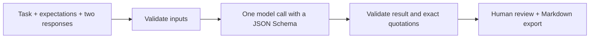

# Eval Detective

**Two responses. One task. Show the evidence.**

A small AI engineering experiment for comparing a baseline and candidate response against explicit expected behavior. Built as part of my learning journey from technical program management into AI engineering.

It produces a preferred response (or a tie / insufficient-evidence verdict), criterion-level checks, supporting excerpts, and limitations. Every nonempty excerpt is verified against the original response before a live result is accepted.

## Try it in two minutes

Requires **Python 3.10+**, with no packages to install:

```sh
git clone https://github.com/vaidveena/eval-detective.git
cd eval-detective
python3 server.py
```

Open **http://127.0.0.1:4173**, choose a sample, and click **View sample verdict**. This displays a clearly labeled, human-authored teaching example. No model is called and no API key is needed. Edited samples cannot reuse the authored verdict.

### Compare your own responses with AI

Set your OpenAI API key in the terminal that starts the server. Keep the key out of files and browser fields:

```sh
export OPENAI_API_KEY='your-api-key'
export OPENAI_MODEL='gpt-4o-mini'
python3 server.py
```

Fill in the task, reference facts / expected behavior, baseline, and candidate. Click **Compare with AI**. API usage is billed to your account. The model is configurable; your account must have access to a model supporting Structured Outputs. `.env.example` documents configuration; `.env` files are not automatically loaded.

### Command line

```sh
python3 detective.py case.example.json
python3 -m unittest -v
# Optional, paid model calls: four cases, one call per case
python3 detective.py --eval
```

## How it works



- `detective.py`: rubric instructions, response schema, API call, validation, CLI and live evaluation runner.
- `server.py`: local-only HTTP server; keeps the key on the server.
- `index.html`, `app.js`, `style.css`: comparison workspace and accessible result cards.
- `examples.json`: four authored cases covering regression, a tie, missing evidence, and an embedded instruction attack.
- `test_detective.py`: offline contract, evidence-integrity, error-handling, and HTTP tests.

Uses the OpenAI Responses API with [Structured Outputs](https://developers.openai.com/api/docs/guides/structured-outputs), requesting `store: false`. It rejects incomplete responses, refusals, invalid shapes, and invented quotations. There are no automatic retries or hidden extra model calls.

## What this teaches

1. **Structured output is a contract, not a truth guarantee.** A well-formed verdict can still be wrong.
2. **Grounding is testable.** A fabricated quote should fail validation rather than quietly reach the UI.
3. **An evaluator needs evaluation.** `--eval` compares model verdicts with authored expectations. Four synthetic examples are a starting point, not a measured accuracy claim.
4. **Uncertainty is useful output.** Missing evidence should not force a winner.

## Verification and limitations

Offline tests use mocked API responses and make no paid requests. They verify software behavior, not model judgment quality. Live API behavior and model accuracy have not been verified in the initial build because no API key was configured. To reproduce a live comparison, add your own key and run the commands above.

The judge can be biased, manipulated, or mistaken. Quote validation only checks exact substring presence; it does not establish truth, completeness, or entailment. Missing quotes can represent omissions. The reference facts must be supplied by the user; the app does not browse or independently fact-check. A human should review decisions before acting.

In live mode, input text goes to OpenAI. The app does not save comparisons to disk or log request bodies, but provider data policies still apply; `store: false` is not a zero-retention promise. Use public or fictional inputs. Bind only to localhost; this development server is not designed for public hosting. The static UI can be served separately for sample walkthroughs, but live judging requires the local server.

## Next experiment

Run each case with the response order swapped and measure whether the preference changes. Then add independently reviewed cases and report agreement, error categories, cost, and latency before expanding the tool.

## Contributing

Useful contributions include reviewed evaluation cases, reproducible judging failures, and accessibility improvements. Keep examples fictional and avoid credentials or confidential project material.

## License

MIT. See [LICENSE](LICENSE).
